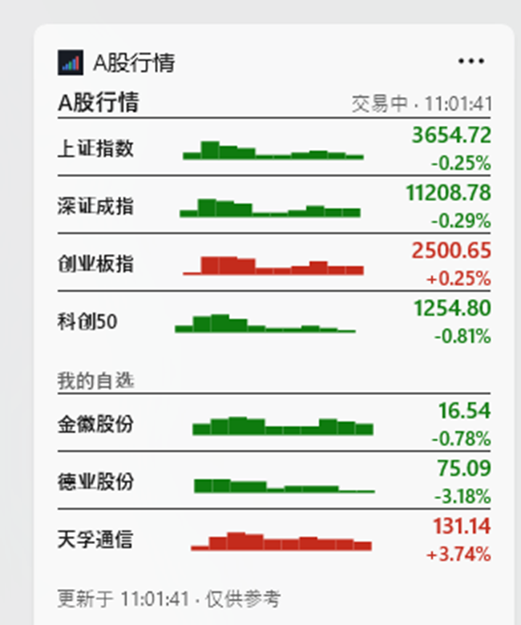

# A股行情 — Windows 11 Widgets 原生组件

A Windows 11 Widgets provider for A-share indices and custom stocks.  
Built with C#, Windows App SDK and Adaptive Cards.


## 展示效果

<p align="center">
  
  <br>
  <sub>大尺寸效果：4 个指数 + 3 只自选股 + 当日分时走势</sub>
</p>

## 功能

- 显示上证指数、深证成指、创业板指、科创50
- 显示 3 只自定义股票
- 红涨绿跌
- 名称和价格之间显示当日分时迷你走势（10 段文本 sparkline）
- 面板打开时立即刷新，之后每 30 秒刷新；面板关闭后暂停请求
- 大尺寸显示全部 7 项；中尺寸只显示 4 个指数

## 环境要求

- Windows 11
- .NET 8 SDK
- PowerShell 5.1
- 可访问 NuGet
- 建议开启 Windows 开发者模式（侧载开发包）
- 首次安装需要允许一次 UAC，用于信任本地自签名证书

## 构建与安装

在仓库根目录执行：

```powershell
powershell -ExecutionPolicy Bypass -File .\tools\build-install.ps1
```

脚本会：

1. `dotnet publish`
2. 拷贝 `Package.appxmanifest` 和图标资源
3. 使用 NuGet 缓存中的 `makeappx.exe` 打包
4. 首次构建时创建本地开发证书并信任，然后签名
5. 卸载旧包并安装新包
6. 校验安装目录中的 DLL 与构建输出的 SHA256 一致

首次构建会在本地生成：

```
StockWidgetDev.pfx
StockWidgetDev.cer
StockWidgetDev.password
```

这些文件包含本地签名材料，**不会也不应该提交到仓库**（`.gitignore` 已排除）。

如果已有 `StockWidgetDev.pfx` 但密码文件丢失，删除旧证书后重新构建，或恢复密码文件。

## 使用

打开 Windows 小组件面板：

```
Win + W
```

添加组件：

1. 点击面板右上角 `+`
2. 找到“A股行情”
3. 点击“添加小组件”

组件右上角 `···` 菜单可以：

- 切换 **中 / 大**
- 移动
- 移除

中尺寸只显示指数；需要全部 7 项时切换到 **Large**。

## 刷新与数据接口

刷新周期：**30 秒**。

- 面板打开 / 组件激活时立即刷新。
- 之后每 30 秒刷新一次；只在组件激活时请求数据。
- 面板关闭后停止请求。
- Widgets 面板本身可能节流，实际渲染时间不保证精确。

数据来自东方财富公开行情接口（非官方 API）：

### 实时报价

```
https://push2.eastmoney.com/api/qt/ulist.np/get
```

- 一次批量获取 4 个指数 + 3 只自选
- 字段：`f2` 现价、`f3` 涨跌幅、`f4` 涨跌额、`f12` 代码、`f13` 市场、`f14` 名称
- 1 个请求 / 次

### 当日分时走势

```
https://push2his.eastmoney.com/api/qt/stock/trends2/get
```

- 每个标的单独请求，`ndays=1`
- 取分钟收盘价 `f53`
- 约 241 个分钟点降采样为 10 个点
- 使用 `▁▂▃▄▅▆▇█` 方块字符绘制迷你曲线
- 7 个请求 / 次

一次完整刷新共 **1 + 7 个请求**。公开接口可能限流或变更，仅供个人参考，不构成投资建议。

## 自定义股票

配置文件：

```
%LOCALAPPDATA%\StockWidgetNative\config.json
```

默认：

```json
{
  "customStocks": [
    "600519",
    "300750",
    "002594"
  ]
}
```

支持：

- `600519`
- `600519,贵州茅台`
- `sh600519`
- `sz300750`
- `bj920000`
- 留空表示不显示

保存后最多 30 秒生效；关闭再打开面板会立即读取。

## 项目结构

| 文件 | 作用 |
| --- | --- |
| `StockWidgetNative.csproj` | .NET 8 + Windows App SDK 项目 |
| `Package.appxmanifest` | MSIX 清单、COM Server、Widgets Provider 注册 |
| `Program.cs` | COM Server 入口与类工厂注册 |
| `ComRegistration.cs` | `CoRegisterClassObject` 和 COM 类工厂 |
| `WidgetProvider.cs` | `IWidgetProvider` 实现、生命周期、刷新调度 |
| `QuoteService.cs` | 行情/分时接口、JSON 解析、sparkline、配置读取 |
| `StockCardBuilder.cs` | 生成 Adaptive Cards JSON |
| `Log.cs` | 本地日志，2 MB 轮转 |
| `Assets/` | 应用图标 |
| `ProviderAssets/` | Widgets 选择器图标和预览图 |
| `tools/build-install.ps1` | 发布、打包、签名、安装、校验 |
| `tools/make-assets.ps1` | 重新生成 PNG 资源 |
| `tools/enable-devmode.ps1` | 开启开发者模式 |

构建产物 `bin/`、`obj/`、`publish/`、`*.msix` 不提交到仓库。

## 校验安装结果

```powershell
Get-AppxPackage StockWidgetNative |
  Select-Object Name, Version, PackageFullName, SignatureKind, Status |
  Format-List
```

构建脚本会输出 MSIX 和已安装 DLL 的 SHA256，并验证二者一致。

## 卸载

```powershell
Get-Process StockWidgetNative -ErrorAction SilentlyContinue | Stop-Process -Force
Get-AppxPackage StockWidgetNative | Remove-AppxPackage
Remove-Item "$env:LOCALAPPDATA\StockWidgetNative" -Recurse -Force
```

如需清理开发证书：

```powershell
Get-ChildItem Cert:\CurrentUser\My, Cert:\CurrentUser\Root, Cert:\LocalMachine\TrustedPeople -ErrorAction SilentlyContinue |
  Where-Object { $_.Subject -eq 'CN=StockWidgetDev' } |
  Remove-Item
```

## 限制

- 组件内容由 Adaptive Cards 渲染，不是 WPF 窗口；字体、颜色和布局受面板限制。
- 行情刷新只在面板激活期间进行，关闭面板后不会后台持续请求。
- 中尺寸不显示自选股；需要全部 7 项时使用大尺寸。
- sparkline 是文本方块曲线，不是交互式图表。
- 同一时间只能固定一个实例。
- 东方财富接口可能限流或变更，请勿用于商业用途。

本项目与 Microsoft、东方财富均无关联。
